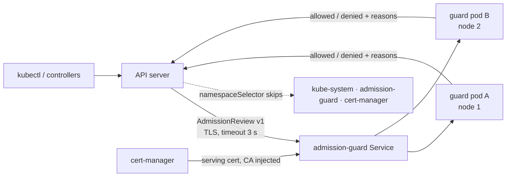

# secure-admission-guard: policy-as-code that can't take the cluster down

A **validating admission webhook in Python** (standard library only, no dependencies) for high-security Kubernetes. Every Pod must use images from the internal registry **pinned by digest**, run as non-root, without privilege escalation, host namespaces, hostPath or added capabilities. Violations are denied with the full list, or returned as warnings in audit mode.

The interesting part is not the policy. It's that **a fail-closed webhook is a single point of failure for the whole cluster**, and this repo shows the outage and the fix.



## Incident drill: one node drain, and nothing can start any more

**Setup** (`deploy/broken/`). The first rollout looked secure: `failurePolicy: Fail`, so nothing unchecked can run. But it had **one replica**, **no PodDisruptionBudget**, and **no `namespaceSelector`**, so the webhook also guarded its own namespace and `kube-system`.

```bash
./drill/run-drill.sh broken     # kind, 3 workers; writes drill/results-broken.txt
./drill/run-drill.sh fixed
```

**What happens.**
1. Routine OS patching drains the node that runs the only guard pod.
2. The ReplicaSet creates a replacement pod. Creating a pod needs the webhook's approval, and the webhook is the pod that's gone. With `failurePolicy: Fail` the API server rejects the create (`failed calling webhook ... no endpoints available`).
3. Deadlock: the guard can't come back, because it is blocking itself. Every other pod create in every namespace fails too, so CoreDNS can't restart and Jobs, rollouts and autoscaling all stop.
4. Recovery needs a human with cluster-admin to delete the `ValidatingWebhookConfiguration`. That is break-glass, and the cluster is unprotected until someone re-applies it.

**Root cause.** Fail-closed is the right choice for security, but it turns the webhook into a dependency of every pod create, **including its own and the control plane's add-ons**.

**Fix** (`deploy/fixed/`), keeping fail-closed:

| Change | Why |
|---|---|
| `namespaceSelector` excluding `kube-system`, `admission-guard`, `cert-manager` by `kubernetes.io/metadata.name` | The guard can always restart itself, and so can cluster add-ons. That label is set by the API server; a custom `exempt: "true"` label could be added by anyone allowed to label namespaces, which would be a bypass |
| `replicas: 2` + required pod anti-affinity + PDB `minAvailable: 1` | A drain takes at most one replica, and the other keeps serving |
| `timeoutSeconds: 3` (default 10) | If it's slow, pod creates fail fast instead of piling up |
| Serving cert from cert-manager, hot-reloaded by the server | Certificate rotation can't cause an outage. Tested: a new cert file is served without a restart |
| TLS handshake in each connection's own thread, 5 s timeout | One slow or broken client can't stall admission for the whole cluster. Tested with a client that connects and never handshakes |

**Prevention.**
- `tools/check_webhook_config.py` runs in CI and rejects a fail-closed webhook that misses any of W1–W5. Its tests prove it fails on the outage config, and that a custom "exempt" label doesn't count.
- The CI `drill` job runs `./drill/run-drill.sh fixed` on kind and requires that CoreDNS restarts after the drain **and** that the bad pod is still denied.
- Metrics `admission_guard_decisions_total{result}` and `admission_guard_seconds_total`. Alert on errors, and on the API server's `apiserver_admission_webhook_rejection_count{error_type="calling_webhook_error"}`.

## Run it

```bash
python3 -m unittest discover -s tests -t . -v   # 16 tests, incl. real HTTPS
(cd tools && python3 -m unittest -v)            # 4 tests
./drill/run-drill.sh fixed
kubectl run x --image=nginx --dry-run=server   # see the full list of violations
```

## Repo layout

| Path | What it is |
|---|---|
| `guard/policy.py` | Pure policy functions: registry prefix (incl. look-alike domains), digest, init/ephemeral containers, privileged, host access, capabilities, non-root |
| `guard/webhook.py` | AdmissionReview v1: echoes the UID, 403 with every reason, audit mode with warnings, `ValueError` on garbage (→ 400), thread-safe metrics |
| `guard/server.py` | HTTPS server: TLS handshake per connection thread with a 5 s timeout, certificate hot reload, separate plain-HTTP port for `/healthz` and `/metrics`, graceful SIGTERM |
| `tests/` | 16 tests, incl. a real HTTPS call, certificate rotation without restart, and a stuck client that must not block others |
| `deploy/fixed`, `deploy/broken` | The safe config and the outage config |
| `tools/` | Webhook config checker + tests |
| `drill/run-drill.sh` | kind reproduction |

## What was run here

- **Ran:** 16 Python tests and 4 checker tests. The server process over real TLS: a bad pod denied with 403, bad input answered with 400, `/metrics` and `/healthz` working, and a clean exit 0.56 s after SIGTERM.
- **Not run here:** the kind drill (no Docker daemon in this environment). Run it in WSL and commit `drill/results-*.txt`. CI also runs the `fixed` drill.

## Where this would go next
Signature verification of images (cosign / Sigstore policy-controller), Gatekeeper or Kyverno for policies owned by security teams, and Falco for runtime detection.
