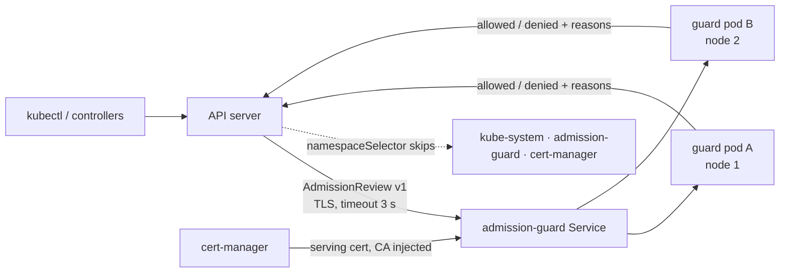

# secure-admission-guard: policy-as-code that can't take the cluster down

A **validating admission webhook in Python** (standard library only, no dependencies) for high-security Kubernetes. Every Pod must use images from the internal registry **pinned by digest**, run as non-root, without privilege escalation, host namespaces, hostPath or added capabilities. Violations are denied with the full list, or returned as warnings in audit mode.

The interesting part is not the policy. It's that **a fail-closed webhook is a single point of failure for the whole cluster**, and this repo shows the outage and the fix.



## Incident drill: one node drain, and nothing can start any more

**Setup** (`deploy/broken/`). The first rollout looked secure: `failurePolicy: Fail`, so nothing unchecked can run. But it had **one replica**, **no PodDisruptionBudget**, and **no `namespaceSelector`**, so the webhook also guarded its own namespace and `kube-system`.

```bash
./drill/run-drill.sh broken     # kind, 3 workers; writes drill/results-broken.txt
./drill/run-drill.sh fixed
```

**What happens.**
1. Routine OS patching drains the node that runs the only guard pod.
2. The ReplicaSet creates a replacement pod. Creating a pod needs the webhook's approval, and the webhook is the pod that's gone. With `failurePolicy: Fail` the API server rejects the create (`failed calling webhook ... no endpoints available`).
3. Deadlock: the guard can't come back, because it is blocking itself. Every other pod create in every namespace fails too, so CoreDNS can't restart and Jobs, rollouts and autoscaling all stop.
4. Recovery needs a human with cluster-admin to delete the `ValidatingWebhookConfiguration`. That is break-glass, and the cluster is unprotected until someone re-applies it.

**Root cause.** Fail-closed is the right choice for security, but it turns the webhook into a dependency of every pod create, **including its own and the control plane's add-ons**.

**Fix** (`deploy/fixed/`), keeping fail-closed:

| Change | Why |
|---|---|
| `namespaceSelector` excluding `kube-system`, `admission-guard`, `cert-manager` by `kubernetes.io/metadata.name` | The guard can always restart itself, and so can cluster add-ons. That label is set by the API server; a custom `exempt: "true"` label could be added by anyone allowed to label namespaces, which would be a bypass |
| `replicas: 2` + required pod anti-affinity + PDB `minAvailable: 1` | A drain takes at most one replica, and the other keeps serving |
| `timeoutSeconds: 3` (default 10) | If it's slow, pod creates fail fast instead of piling up |
| Serving cert from cert-manager, hot-reloaded by the server | Certificate rotation can't cause an outage. Tested: a new cert file is served without a restart |
| TLS handshake in each connection's own thread, 5 s timeout | One slow or broken client can't stall admission for the whole cluster. Tested with a client that connects and never handshakes |

**Prevention.**
- `tools/check_webhook_config.py` runs in CI and rejects a fail-closed webhook that misses any of W1–W5. Its tests prove it fails on the outage config, and that a custom "exempt" label doesn't count.
- The CI `drill` job runs `./drill/run-drill.sh fixed` on kind and requires that CoreDNS restarts after the drain **and** that the webhook returns a real denial (`denied the request`). If the webhook answers with a connection error instead, the drill stops as invalid.
- Metrics `admission_guard_decisions_total{result}` and `admission_guard_seconds_total`. Alert on errors, and on the API server's `apiserver_admission_webhook_rejection_count{error_type="calling_webhook_error"}`.

## A second, real incident: the scan gate caught my own image

This one wasn't staged. On the first push to GitHub:

1. **The `scan` job failed before it started:** `Unable to resolve action aquasecurity/setup-trivy@v0.2.2`. I had pinned `trivy-action` to a commit (v0.29.0), but **that action pulled its own dependency by tag**, and the tag no longer existed. Pinning only protects you if everything you call is pinned too. Fix: `trivy-action` v0.36.0, which pins `setup-trivy` by commit SHA.
2. **Then the scan did its job and blocked the build:** **5 HIGH CVEs** in libraries bundled inside **pip** (e.g. `msgpack`). The OS layer (Debian 13.7) was clean. The webhook uses only the standard library and never runs pip, so instead of adding exceptions I **removed pip (and `ensurepip`) from the runtime image**. Result: scan clean, smaller image, less to attack.

| Run | test | drill (kind) | scan |
|---|---|---|---|
| #2 | ✅ | ✅ | ❌ action dependency missing |
| #3 | ✅ | ✅ | ❌ 5 HIGH CVEs in pip's bundled libraries |
| #4 | ✅ | ✅ | ✅ |

## A third, real incident: my green drill was proving nothing

The first time I ran the drill on my own laptop, step one ("unpinned image is denied") did not show a denial. It showed this:

```
failed calling webhook "pods.admission-guard.io": Post "https://admission-guard.admission-guard.svc:443/validate?timeout=10s":
read: connection reset by peer
```

**Cause.** The API server calls `/validate?timeout=10s`. My handler compared the whole request path, query string included, with `/validate`, so every real call got a 400 before its body was read. The socket was then closed with unread data on it, and the client got a TCP reset. My unit tests and my `curl` checks all used `/validate` with no query, so all of them passed.

**Why CI was still green.** The CI check was `grep -qi "denied"` on the results file, and the drill's own heading line says "...is denied". The check matched the heading, not a denial. A check that cannot fail is not a check.

**Fix.**
1. Compare `urlsplit(self.path).path`, so the query string is ignored.
2. New test `test_api_server_query_string_is_accepted` posts to `/validate?timeout=10s` over real TLS. It fails on the old code and passes on the fix.
3. The drill now stops with `DRILL INVALID` unless the webhook returns `denied the request`, and CI greps for that exact phrase.

The lesson: test against the real caller, not your idea of it. A kind cluster found in one run what 16 tests didn't.

## Hardening after a self-review

I reviewed my own manifests the way a security team would, and fixed three gaps:

| Gap | Why it mattered | Fix |
|---|---|---|
| `FROM python:3.13-slim` by tag | My webhook rejects any image without a digest, yet my own image was built from a movable tag | Base image pinned by `@sha256:` digest. CI fails on a `FROM` without one, and Dependabot opens a PR when a new digest is published, so pinning doesn't freeze old CVEs in |
| No NetworkPolicy | Any pod could reach the webhook and its metrics | Default deny. 8443 open for the API server (not a pod, so TLS is the control), 8080 only from the `monitoring` namespace, no egress at all |
| No PriorityClass | Under memory pressure the guard could be evicted like any app, and every pod create in the cluster depends on it | `admission-guard-critical`: above all apps, below the built-in `system-*` classes |

Also: a `.dockerignore` that sends only `guard/` to the build, and a comment that the kind image `admission-guard:dev` is `registry.internal/admission-guard@sha256:...` in production.

## The platform around it: Terraform, Argo CD, Prometheus, Alertmanager, Grafana

A guard nobody watches is a guard that fails quietly. `platform/` puts it on a small
platform and proves, end to end, that the pieces work together.

```
Terraform (helm provider)
  ├─ kube-prometheus-stack ── Prometheus · Alertmanager · Grafana
  ├─ cert-manager ─────────── serving cert + expiry metrics
  ├─ Argo CD
  └─ Argo CD Applications ──► Git (this repo)
        ├─ platform/gitops/guard   = deploy/fixed + platform exemptions (Kustomize)
        └─ deploy/observability    = PodMonitor · PrometheusRule (SLO) · Grafana dashboard
```

| Piece | What it does |
|---|---|
| **SLO** | SLI = share of API server → webhook calls that got an answer (allow *or* deny). Target 99.9 % / 30 days |
| **Burn-rate alerts** | Fast burn (14.4×, 1 h and 5 m windows) pages; slow burn (6×, 6 h and 30 m) is a ticket |
| **Other alerts** | `AdmissionGuardDown` (critical) · `Degraded` (one replica left) · `Slow` · `CertExpiringSoon`. Each links to [docs/runbook.md](docs/runbook.md) |
| **Alertmanager** | critical → `oncall`, warning → `ticket`; a critical alert inhibits its warning, so one page, not two |
| **Grafana** | "Admission Guard" dashboard, provisioned from a ConfigMap in Git: replicas, SLI, burn rate, decisions, API-server view of webhook calls, cert days left |
| **GitOps** | Argo CD with self-heal: a manual `kubectl scale` is reverted. cert-manager's injected CA is in `ignoreDifferences`, or Argo CD would keep deleting it |
| **Tests** | `promtool test rules`: each alert fires when it should and stays quiet when it shouldn't |

`./platform/up.sh` (about 10 minutes on kind) checks six things and writes `platform/results.txt`:
1. the guard (deployed by Argo CD) denies a bad pod;
2. Prometheus scrapes both replicas;
3. the rules and dashboard are loaded;
4. a manual scale-down is reverted by Argo CD;
5. with GitOps paused and the guard at 0, **`AdmissionGuardDown` reaches Alertmanager**;
6. GitOps resumed, the guard is restored.

Then `bash platform/ui.sh` opens Grafana, Argo CD, Prometheus and Alertmanager in the browser (port-forwards in the background, logins printed). Live demos: `bash platform/ui.sh selfheal` (Argo CD undoes a manual scale-down) and `bash platform/ui.sh page` (guard down → page in Alertmanager → GitOps restores it). `bash platform/ui.sh stop` ends the port-forwards.

CI: the `platform` workflow runs `terraform fmt/validate`, promtool, the Kustomize builds, and on `main` the full drill with Argo CD deploying the exact commit.

## Run it

```bash
python3 -m unittest discover -s tests -t . -v   # 17 tests, incl. real HTTPS
(cd tools && python3 -m unittest -v)            # 4 tests
./drill/run-drill.sh fixed
kubectl run x --image=nginx --dry-run=server   # see the full list of violations
```

## Repo layout

| Path | What it is |
|---|---|
| `guard/policy.py` | Pure policy functions: registry prefix (incl. look-alike domains), digest, init/ephemeral containers, privileged, host access, capabilities, non-root |
| `guard/webhook.py` | AdmissionReview v1: echoes the UID, 403 with every reason, audit mode with warnings, `ValueError` on garbage (→ 400), thread-safe metrics |
| `guard/server.py` | HTTPS server: TLS handshake per connection thread with a 5 s timeout, certificate hot reload, separate plain-HTTP port for `/healthz` and `/metrics`, graceful SIGTERM |
| `tests/` | 17 tests, incl. a real HTTPS call with the API server's `?timeout=` query, certificate rotation without restart, and a stuck client that must not block others |
| `deploy/fixed`, `deploy/broken` | The safe config (incl. NetworkPolicy and PriorityClass) and the outage config |
| `tools/` | Webhook config checker + tests |
| `drill/run-drill.sh` | kind reproduction |
| `platform/` | Terraform, Argo CD apps, promtool tests, `up.sh` / `down.sh` |
| `deploy/observability/` | PodMonitor, SLO PrometheusRule, Grafana dashboard |
| `docs/runbook.md` | What to do for each alert |

## What was run here

- **Ran:** 17 Python tests and 4 checker tests. The server process over real TLS: a bad pod denied with 403, bad input answered with 400, `/metrics` and `/healthz` working, and a clean exit 0.56 s after SIGTERM.
- **On kind (WSL):** the drill, after the fix above. Results in `drill/results-broken.txt` and `drill/results-fixed.txt`.
- **In GitHub Actions:** the kind drill (`fixed`) on every push, now requiring a real denial. Trivy image scan clean.

## Where this would go next
Signature verification of images (cosign / Sigstore policy-controller), Gatekeeper or Kyverno for policies owned by security teams, and Falco for runtime detection.
